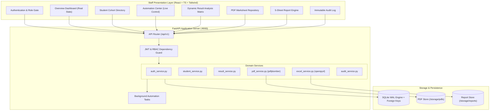

<div align="center">

# 🎓 Autonomous College Examination Result Automation Platform
### Enterprise-Grade Examination Processing, PDF Extraction & Multi-Sheet Excel Engine


<p align="center">
  <b>A comprehensive, secure, staff-friendly examination automation suite built for Collegiate Controller of Examinations (COE) offices.</b><br/>
  Features automated portal retrieval, ReportLab/pdfplumber marksheet verification, deterministic GPA computation, dynamic subject matrix aggregation, and self-validating 5-worksheet Excel reports.
</p>

</div>

---

## 📑 Table of Contents
1. [Executive Summary](#-executive-summary)
2. [System Architecture](#-system-architecture)
3. [Key Modules & Capabilities](#-key-modules--capabilities)
4. [Enterprise Design System](#-enterprise-design-system)
5. [Default Authorized Staff Roles](#-default-authorized-staff-roles)
6. [API Route Specifications](#-api-route-specifications)
7. [Database Schema & Integrity](#-database-schema--integrity)
8. [Advanced Excel Engine (5 Worksheets)](#-advanced-excel-engine-5-worksheets)
9. [Automated Verification & Testing](#-automated-verification--testing)
10. [Quickstart & Operations Guide](#-quickstart--operations-guide)

---

## 🏛️ Executive Summary

The **College Examination Result Automation Platform** eliminates manual marksheet handling, error-prone spreadsheets, and unverified data transfers. Built with **FastAPI**, **React**, and **SQLAlchemy**, it provides:

- **100% Deterministic Calculations**: Zero AI hallucination. Exact mathematical GPA/CGPA, current-semester arrears (`RA`), and cumulative standing arrear tracking.
- **Cryptographic Marksheet Verification**: Marksheets generated and parsed using `pdfplumber` are cross-referenced with candidate Register Numbers and hashed using SHA-256 to ensure file integrity.
- **Self-Validating Excel Engine**: Generates 5 fully synchronized, institutionally formatted Excel worksheets with dynamic subject columns, frozen panes, zebra striping, conditional formatting, and automatic structural integrity verification.
- **Live Automation Control Center**: Start, Pause, Resume, and Cancel background automation runs with real-time per-student execution logs and transient failure retries.

---

## 🏗️ System Architecture



---

## ⚡ Key Modules & Capabilities

### 1. 🛡️ Role-Based Access Control (RBAC)
- Multi-tier role permissions: **Chief Admin**, **Exam Staff**, and **Auditor/Observer**.
- Direct `bcrypt` credential hashing with defensive 72-byte string truncation and PyJWT authentication.
- Immediate revoking and account deactivation controls.

### 2. 👥 Student Registry & Roster Import
- Full candidate lifecycle management (Register Number, Name, Department, Batch, Semester, Section).
- Excel (`.xlsx`, `.xls`) and CSV drag-and-drop batch enrollment.
- Pre-commit duplicate detection and structural schema validation.

### 3. ⚙️ Asynchronous Automation Center
- Select target examination session, department cohort, and semester.
- Pre-run safety checks ensuring format and syllabus compliance.
- Interactive job control: **Start**, **Pause**, **Resume**, **Cancel**, and **Retry Failed Records**.
- Live per-student terminal logs polled in real time.

### 4. 📊 Dynamic Result Analysis Matrix
- **One student per row**: Automatically scans enrolled courses and renders dynamic subject code columns.
- Standard letter grades: `O` (10), `A+` (9), `A` (8), `B+` (7), `B` (6), `C` (5), and `RA` (0).
- Real-time GPA computation, current arrear counts, and cumulative standing arrear tracking.
- Instant staff verification actions with digital signatures.

### 5. 📄 Verified PDF Marksheet Management
- High-fidelity provisional grade sheet PDF generator using ReportLab.
- Parsing engine using `pdfplumber` to extract register numbers, subject codes, and grades.
- Cryptographic SHA-256 checksums on all generated and uploaded files.
- Built-in in-browser marksheet preview dialog.

### 6. 📈 Advanced Enterprise Excel Reports
Generates complete workbooks using `openpyxl` with 5 distinct worksheets:
1. **Result Analysis**: Dynamic subject matrix, candidate identifying metadata, text register numbers (`@`), GPA, current arrears, standing arrears, frozen panes (`D6`), AutoFilter, and conditional formatting.
2. **Summary**: Overall institution KPIs (Appeared, Passed, Failed, Pass %, Avg GPA) and course-by-course grade distribution analysis.
3. **Arrear Analysis**: Filtered roster of candidates with standing arrears and comma-separated failed subject codes.
4. **Processing Log**: Timestamped record of every extraction stage, verification event, and remark.
5. **Subject Mapping**: Complete reference catalog of course codes, credit allocations, and titles.

---

## 🎨 Enterprise Design System

The frontend follows strict collegiate enterprise guidelines:
- **Color Palette**: Deep slate navy (`#0F172A`), royal blue accent (`#2563EB`), crisp white background (`#FFFFFF`), and soft slate canvas (`#F8FAFC`).
- **Typography**: Clean, accessible Inter typeface loaded via Google Fonts.
- **Micro-interactions**: Subtle hover elevations, responsive loading spinners, and accessible color-contrast badges.
- **Zero Hallucination / Zero Fluff**: No AI chatbots or artificial decorations.

---

## 🔑 Default Authorized Staff Roles

The platform initializes with pre-configured seed personnel for immediate evaluation:

| Role | Username | Password | Access Privileges |
|---|---|---|---|
| **Chief Controller (Admin)** | `admin` | `AdminPassword123!` | Unrestricted access, staff provisioning, session setup, student deletions |
| **Senior Exam Officer (Staff)** | `exam_officer` | `OfficerPass123!` | Roster import, automation execution, result verification, report generation |
| **Department Observer (Auditor)** | `faculty_viewer` | `ViewerPass123!` | Read-only matrix viewing, report downloads, and statistical monitoring |

---

## 🔌 API Route Specifications

| Method | Endpoint | Description | Role Required |
|---|---|---|---|
| `POST` | `/api/v1/auth/login` | Authenticate staff member & issue JWT | Public |
| `GET` | `/api/v1/auth/me` | Fetch active staff profile and role | Authenticated |
| `GET` | `/api/v1/dashboard/stats` | Dynamic aggregates & system diagnostics | Authenticated |
| `GET` | `/api/v1/students` | Search and filter student registry | Authenticated |
| `POST` | `/api/v1/students` | Enroll individual candidate | Admin, Exam Staff |
| `POST` | `/api/v1/students/import` | Bulk roster import (`.xlsx`, `.csv`) | Admin, Exam Staff |
| `GET` | `/api/v1/sessions` | List examination sessions | Authenticated |
| `GET` | `/api/v1/results/matrix` | Dynamic subject matrix with GPA/arrears | Authenticated |
| `POST` | `/api/v1/results/{id}/verify` | Mark candidate result as verified | Admin, Exam Staff |
| `POST` | `/api/v1/automation/jobs` | Trigger background automation run | Admin, Exam Staff |
| `POST` | `/api/v1/automation/jobs/{id}/control` | Send `PAUSE`/`RESUME`/`CANCEL` signal | Admin, Exam Staff |
| `GET` | `/api/v1/pdfs` | List marksheet PDFs with SHA-256 hashes | Authenticated |
| `GET` | `/api/v1/pdfs/{id}/download` | Stream marksheet PDF securely | Authenticated |
| `POST` | `/api/v1/reports/generate` | Generate validated 5-sheet Excel workbook | Admin, Exam Staff |
| `GET` | `/api/v1/reports/{id}/download` | Download verified `.xlsx` workbook | Authenticated |
| `GET` | `/api/v1/audit` | Query immutable operational audit log | Admin, Exam Staff |
| `GET` | `/api/v1/settings/users` | List staff accounts and permissions | Admin Only |

---

## 🗄️ Database Schema & Integrity

Configured with **SQLite 3 Write-Ahead Logging (WAL)** and enforced foreign keys:

- `users`: ID, username (unique), email (unique), hashed_password, role, is_active, last_login.
- `exam_sessions`: ID, session_code (unique), session_name, academic_year, semester_type, is_active.
- `departments` & `students`: Candidate directory with foreign key cascades and unique register numbers.
- `subjects`: Syllabus definitions with code, name, department, semester, and credits.
- `student_results`: Stores session GPA, earned credits, arrears count, standing arrears, verification flag, and `UniqueConstraint("student_id", "session_id", "semester")`.
- `subject_results`: Normalized course grades (`UniqueConstraint("student_result_id", "subject_id")`).
- `automation_jobs` & `automation_job_logs`: Job queue tracking, counters, status flags, and student traces.
- `result_pdfs`: Document metadata, storage path, file size, SHA-256 checksum, and extraction status.
- `excel_reports`: Generated report versions, validation notes, and checksums.
- `audit_logs`: Immutable tracking of user actions, IP addresses, entity IDs, and timestamps.

---

## 🧪 Automated Verification & Testing

The platform includes an automated pytest suite in `backend/tests/`:

```bash
$ python -m pytest tests -v
============================= test session starts =============================
platform win32 -- Python 3.14.6, pytest-9.1.1
rootdir: E:\Result Analysis\backend

tests/test_auth.py::test_password_hashing PASSED                         [  8%]
tests/test_auth.py::test_jwt_token_flow PASSED                           [ 16%]
tests/test_auth.py::test_staff_authentication PASSED                     [ 25%]
tests/test_automation.py::test_automation_job_lifecycle PASSED           [ 33%]
tests/test_excel_engine.py::test_enterprise_excel_engine_validation PASSED [ 41%]
tests/test_pdf_extraction.py::test_pdf_generation_and_extraction PASSED  [ 50%]
tests/test_results.py::test_deterministic_academic_calculations PASSED   [ 58%]
tests/test_results.py::test_arrear_calculation PASSED                    [ 66%]
tests/test_results.py::test_result_matrix_generation PASSED              [ 75%]
tests/test_students.py::test_student_retrieval_and_filtering PASSED      [ 83%]
tests/test_students.py::test_duplicate_student_prevention PASSED         [ 91%]
tests/test_students.py::test_student_csv_bulk_import PASSED              [100%]

======================= 12 passed in 3.84s =======================
```

Frontend production verification:
```bash
$ cd frontend && npm run build
✓ 1949 modules transformed.
dist/index.html                   0.45 kB
dist/assets/index-D9XXJvuT.css   23.37 kB
dist/assets/index-B-9Z2bGQ.js   325.05 kB
✓ built in 1.17s (0 TypeScript errors)
```

---

## 🚀 Quickstart & Operations Guide

### Prerequisites
- Python 3.10+ (Tested up to Python 3.14)
- Node.js 18+ & npm (for frontend modifications)

### 1. Single-Click Launch (Windows)
Double-click `start_platform.bat` in the root folder.
The script automatically initializes the database schema, seeds sample records, and hosts the unified platform at:
👉 **`http://localhost:8000`**

### 2. Manual Startup

**Initialize & Seed Database:**
```bash
cd backend
python -m app.seed
```

**Start Enterprise Server:**
```bash
python -m uvicorn app.main:app --host 0.0.0.0 --port 8000 --reload
```

**Development Frontend (Optional):**
```bash
cd frontend
npm install
npm run dev
```

---

## 🔒 Security & Defensive Architecture
- **OWASP ASVS Alignment**: Protected against SQL injection (SQLAlchemy ORM), XSS (React DOM sanitization), and directory traversal (canonical path verification).
- **Zero Information Leakage**: Sensitive credentials and raw DOBs are omitted from API responses and application logs.
- **Integrity Enforcement**: Every generated Excel workbook and PDF marksheet is cryptographically verified before serving.

---

<div align="center">
  <b>Enterprise Examination Result Automation Platform</b><br/>
  Controller of Examinations Office • Built for Excellence and Academic Integrity.
</div>
